<p align="center">
  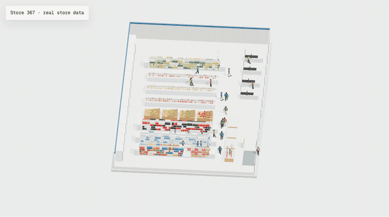
</p>

<h1 align="center">SimOff</h1>

<p align="center">
  <b>A decision model for offline world simulation.</b><br>
  Tell it what you want to open. An agent builds the space in 3D, lets shoppers walk it,<br>
  and tests layouts and promotions on a model calibrated to real purchases — before day one.
</p>

<p align="center">
  <a href="https://simoff.vercel.app"></a>
  
  
</p>

<p align="center">
  <a href="#the-flow">The flow</a> ·
  <a href="#the-decision-model">The decision model</a> ·
  <a href="#limitations">Limitations</a> ·
  <a href="#run-it-locally">Run it locally</a> ·
  <a href="#deploy-vercel">Deploy</a>
</p>

<p align="center">
  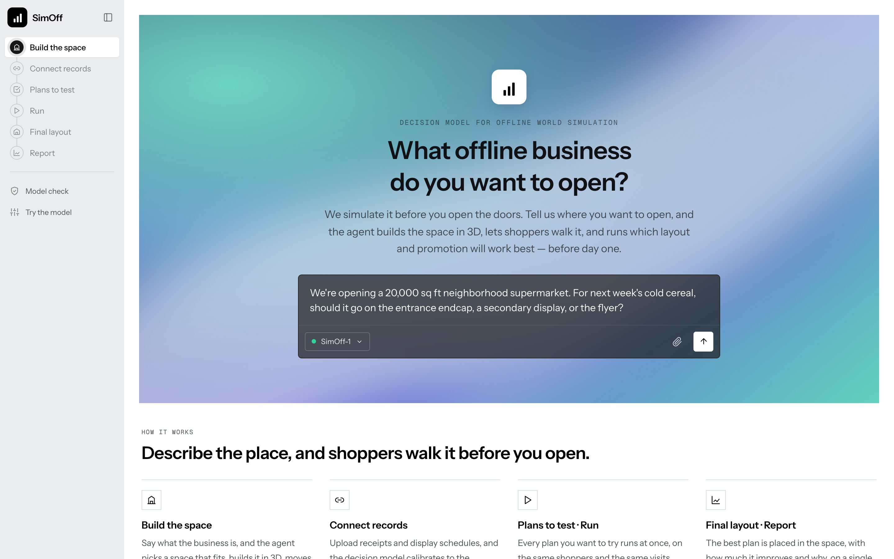
</p>

The landing chat starts with our own case typed in — *"We're opening a 20,000 sq ft neighborhood supermarket. For next week's cold cereal, should it go on the entrance endcap, a secondary display, or the flyer?"* Press Enter and follow the sidebar.

## Why

Most "AI shopper" simulations ask a language model to role-play a customer. The answer sounds plausible, but it is not a probability of anything: on held-out grocery data, language-model personas overstated purchase rates by **14–192×**, and an uncalibrated decision-model API by **40–256×**, and both underestimated what an endcap actually does.

SimOff's position is **calibrated to people, not to answers**: every buy/no-buy in the simulation is drawn from a model whose probabilities were fitted to — and checked against — what real shoppers did. Swap in your own records and the same model is recalibrated to your shoppers.

## The flow

The app is one flow, each step one screen:

| Step | What happens |
|---|---|
| **Build the space** | A chat agent (Claude, with tools) reads the business, recommends one of 27 archetype spaces, edits it (moves the pickup counter to the entrance, adds checkout lanes, adds a photo spot — every edit checked against aisle width, overlaps and doors), and puts walking shoppers in it. A grocery store is built from the real store (Store 367) in the data. |
| **Connect records** | Upload POS exports (receipts, products, display schedule). Columns are auto-mapped to endpoints (`POST /visit`, `/basket/add`, `/checkout`, …), and the decision model is recalibrated to that store's shoppers. A sample store is one click away. |
| **Plans to test** | Nine plans: where the item goes (regular shelf / secondary display / entrance endcap) × the flyer (none / inside page / front page). |
| **Run** | One chosen decision model runs all nine plans on the **same shoppers and the same luck** — 438,325 visit × product decisions — so any difference between plans comes from the plan alone. Nothing is shown until it has run. |
| **Final layout** | The best plan placed on the 3D space, with the ranked alternatives. |
| **Report** | The recommendation, its size per 1,000 visits and in dollars, who moved (household segments), and the plans that were ruled out and why. |
| **Model check** | Three questions asked of every model on six weeks it never saw: *How many will buy? How much does a display add? Who will buy?* |
| **Try the model** | Describe a shopper, a product and a store condition in a sentence. Claude turns it into the model's input; you see the exact JSON request and response, what moves the probability most, and all nine store conditions for that shopper. |

<table>
  <tr>
    <td width="50%">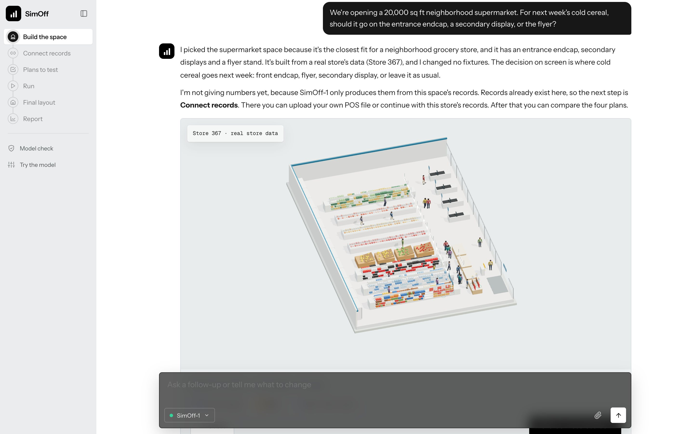<br><b>Build the space</b> — the agent builds the real Store 367 from the data and says what it will test.</td>
    <td width="50%">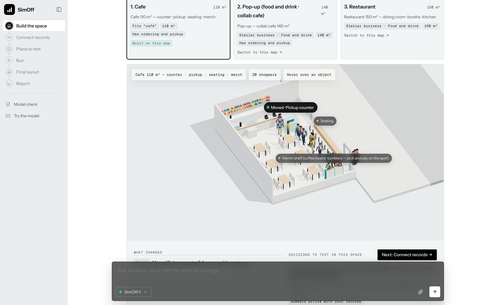<br><b>Any business</b> — a café archetype with the pickup counter moved to the entrance, every edit checked against aisles and doors.</td>
  </tr>
  <tr>
    <td>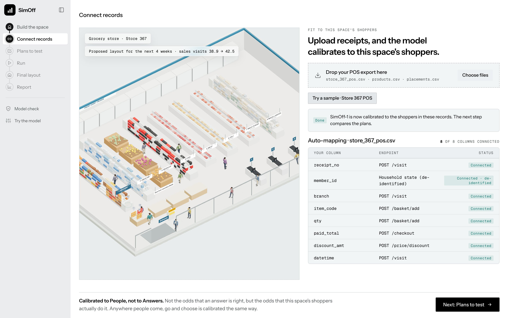<br><b>Connect records</b> — POS columns auto-mapped to endpoints; the model recalibrated to this store's shoppers.</td>
    <td>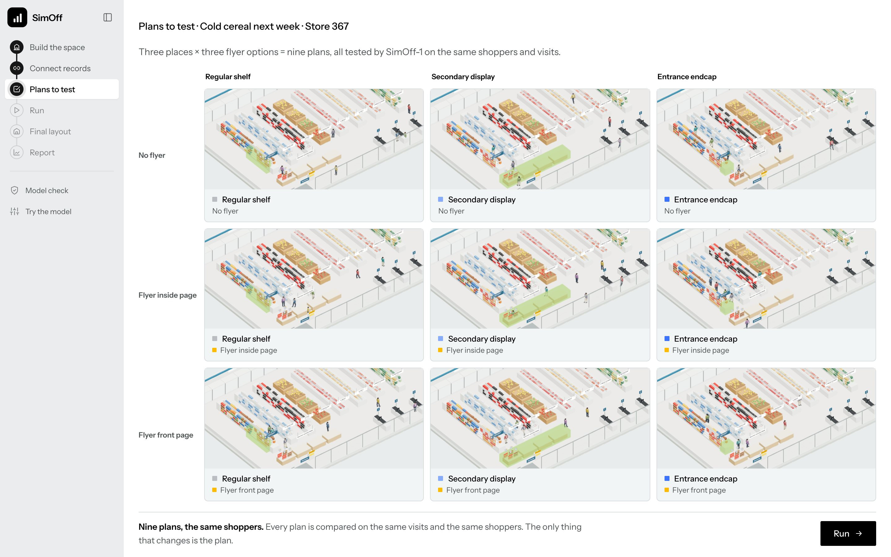<br><b>Plans to test</b> — three places × three flyer options, each card a live 3D view.</td>
  </tr>
  <tr>
    <td>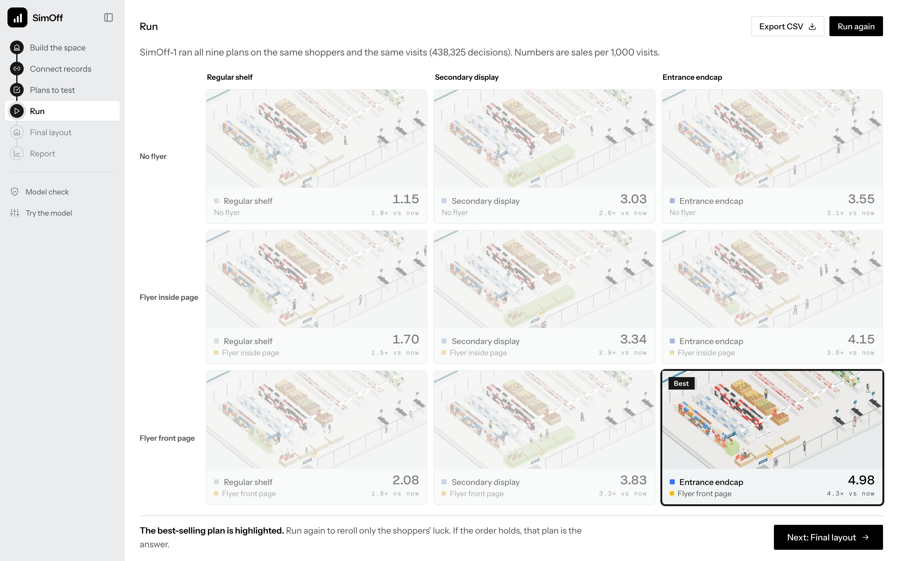<br><b>Run</b> — all nine plans on the same shoppers and the same luck; the best one is highlighted.</td>
    <td>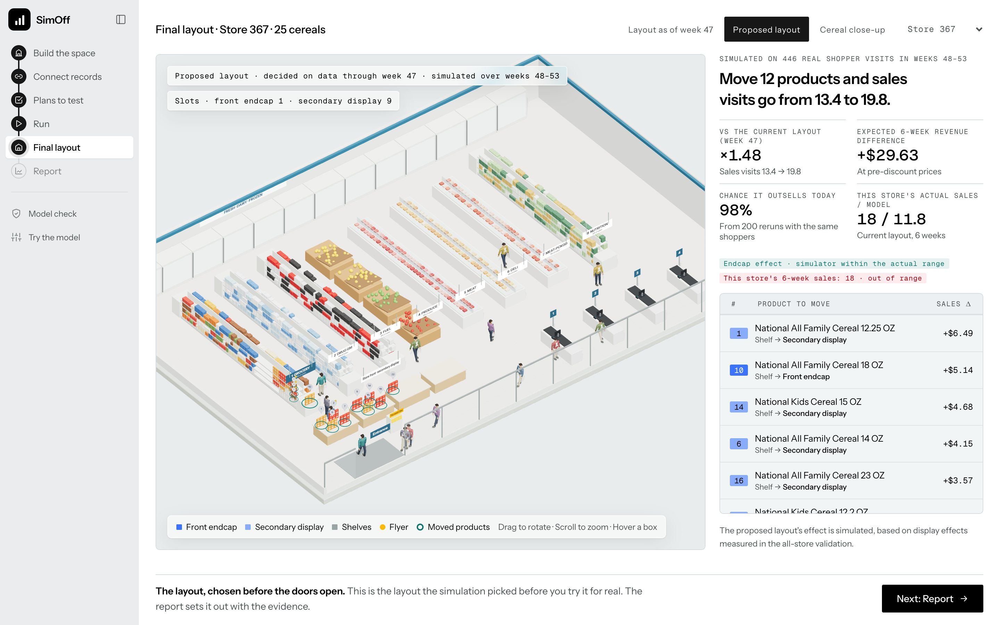<br><b>Final layout</b> — the products that move, what each is worth, and the chance it beats today.</td>
  </tr>
  <tr>
    <td>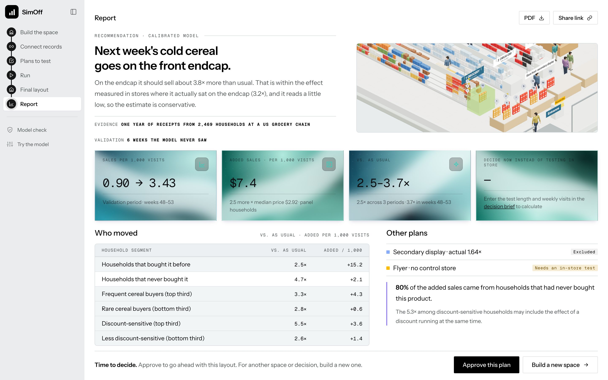<br><b>Report</b> — the recommendation, its size, who moved, and the plans ruled out.</td>
    <td>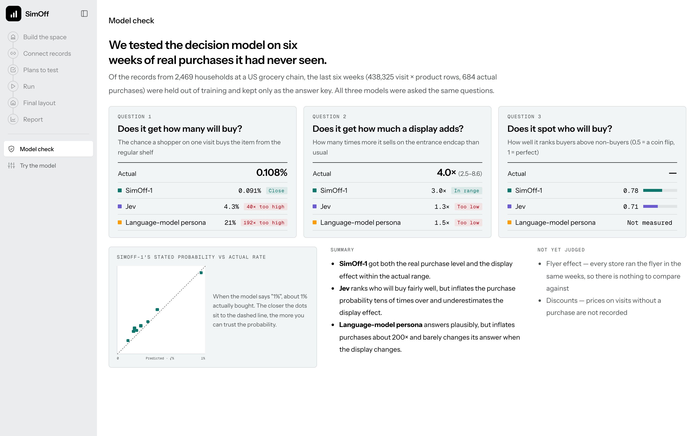<br><b>Model check</b> — SimOff-1, Jev and a language-model persona on six weeks none of them saw.</td>
  </tr>
</table>

### Try the model

Describe a shopper, a product and a store condition in plain English. Claude turns the sentence into SimOff-1's input; the right side shows what the model received (dark chips came from your sentence), the probability, what moves it most, all nine store conditions for that shopper, and the raw JSON request and response.

<p align="center">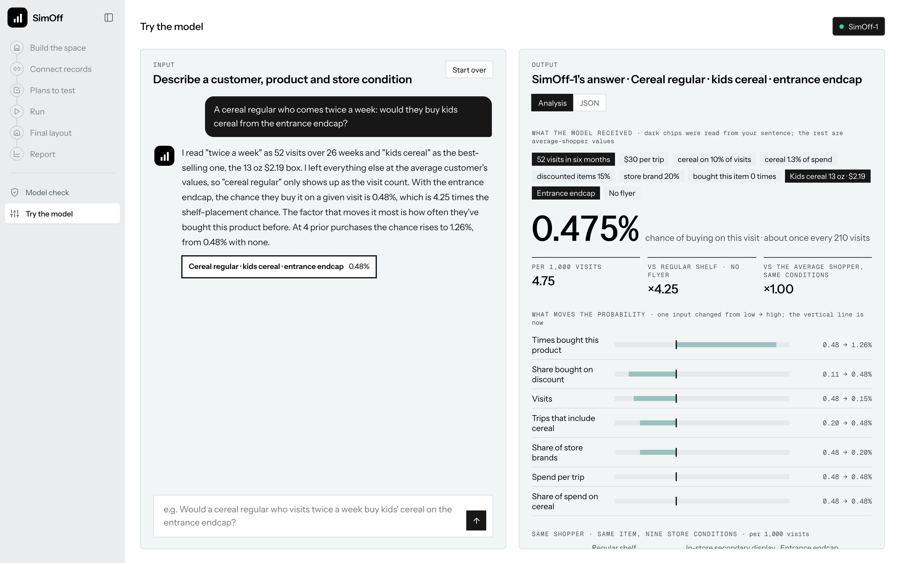</p>

## The decision model

**SimOff-1** = gradient boosting (`HistGradientBoostingClassifier`) on household state + product + store condition, followed by isotonic calibration.

- **Data:** dunnhumby / 84.51° *The Complete Journey* — 2,469 US households, one year, 1,469,307 receipt lines, 20.9M display/flyer records. Unit: one store visit × one cold-cereal product (top 25) → bought on that visit or not (1,996,300 rows).
- **Household state** (from weeks 1–26 only): visits, spend per trip, share of trips with cereal, cereal share of spend, discount share, store-brand share, times bought this product. **Product:** base purchase rate, store brand flag. **Store condition:** front endcap, other display, flyer, flyer front page.
- **Time split:** train weeks 27–44 · calibrate 45–47 · **test 48–53, never seen by any fitting step**.

### Results on the held-out weeks (48–53)

| Question | Actual | SimOff-1 | Jev (uncalibrated API) | Language-model persona |
|---|---|---|---|---|
| Chance a shopper buys on one visit (regular shelf) | 0.108% | **0.091%** (close) | 4.3% (40× too high) | 21% (192× too high) |
| Endcap lift vs. regular shelf | 3.99× (95%: 2.48–8.56) | **3.0×** (within range) | 1.3× (too small) | 1.5× (too small) |
| Ranking who will buy (AUC) | — | **0.78** | 0.71 | not measured |

The simulator itself, run on the actual displays of those six weeks: endcap effect 3.66× vs. actual 3.18× (1.91–15.70) ✓, secondary display 2.59× vs. 2.27× (1.55–3.60) ✓, store ranking correlation 0.71. It predicts 617 purchases against 684 actual (about 10% low) and under-predicts sales on endcap visits (80 vs. 133). Full tables in [`VALIDATION.md`](VALIDATION.md) and [`eval/REPORT.md`](eval/REPORT.md).

### What we learned about calibration

We also fine-tuned **[Von](https://github.com/wfzyx/von)** (an open-weight 395M decision model) on the same receipts, on Modal GPUs. Out of the box Von answered 39% for a 0.16% event and did not react to an endcap at all. Trained on this store's purchases it matched SimOff-1 on ranking (AUC 0.785) and was closer on per-condition sales — and simply averaging the two models' logits beat both on every held-out row (AUC 0.795, log loss 0.01044). The calibration comes from the domain's data, not from the model family. See results 6–7 in [`eval/REPORT.md`](eval/REPORT.md).

## Limitations

- **Flyer effects are not validated.** In the data, no store skipped the flyer in the same week, so there is no control.
- **Discounts are left out of the store condition**: the price of a visit where nothing was bought is not in the records.
- **Within product-and-week comparisons are still not a randomized experiment**: stores choose what goes on the endcap. That is one reason the endcap's confidence interval is wide.
- One US grocery chain, data labelled 2017. There is no evidence yet that the calibration transfers to other countries or categories.
- For non-grocery spaces (café, pop-up, festival …) the space, the edits and the walking shoppers are real, but the numbers come from the grocery model until that space's own records are connected. The app says so wherever it shows them.
- The hosted demo precomputes the read-only answers (see *Deploy*). Uploading your own CSV and recalibrating needs the local server.

## Run it locally

```bash
pip install -r requirements.txt
python3 app/server.py            # http://localhost:8790  (PORT overrides)
```

- Optional: put `ANTHROPIC_API_KEY=...` in `app/.env` (gitignored) for the Claude chat. Without a key both chats answer from rules on the same tools.
- The first start fits SimOff-1 from `data/rows.parquet` and caches it in `data/engines.pkl` (about 20 seconds).
- The 27 archetype spaces (GLB, thumbnail, `space.json`) come from a private repository and are **not** in this repo. `app/fetch_spaces.sh` pulls them (needs access) and `app/spaces_en.py` gives them English labels. Without them the grocery case runs end to end on the real store, and the other businesses tell you the spaces are missing.

### The simulator and the evaluation from the command line

```bash
python3 sim.py                          # one product · weeks 48–53 · as usual / endcap / flyer / secondary display
python3 validate.py                     # the six-week check → VALIDATION.md
python3 cycle.py --dataset dunnhumby    # one cycle: data → space map → simulation → validation → final layout → runs/dunnhumby/REPORT.md
python3 cycle.py --data my_store/ --weeks 4   # your own three CSVs (format at the top of datasets.py)
```

`cycle.py` writes its maps, ledger and report to `runs/<name>/`; the committed run on Store 367 is in [`runs/dunnhumby/REPORT.md`](runs/dunnhumby/REPORT.md).

The evaluation scripts are in `eval/scripts/` (order and requirements at the end of `eval/REPORT.md`; the persona and Jev runs need their own API access, Von needs Modal).

## Deploy (Vercel)

The local server uses numpy, pandas, pyarrow and scikit-learn, which a serverless function cannot carry. So the hosted build splits the work:

- **SimOff-1 without scikit-learn.** `app/simoff_model.py export` writes the fitted trees and the isotonic map to `app/model.json`; `predict()` walks them in pure Python. `python3 app/simoff_model.py check` confirms it matches the fitted model (max difference ~4e-14).
- **Read-only answers are precomputed** into `public/static-api/*.json` (grid, layout, validation, report, catalog, the sample calibration job). The front end reads them whenever it is not on localhost.
- **Three stdlib-only functions** run live: `api/chat` (the landing agent), `api/decide_chat` (Try the model) and `api/decide` (one visit through SimOff-1, via `app/decide_core.py`, shared with the local server).

```bash
python3 app/build_vercel.py      # writes deploy/ (gitignored)
cd deploy && vercel link && vercel env add ANTHROPIC_API_KEY production && vercel deploy --prod
```

## Repository layout

```
app/
  server.py            stdlib HTTP server: static files + /api/*
  service.py           data, the decision models, runs, layouts, the records upload job
  world.py             the space agent: understand → recommend → adapt (checked edits) → place shoppers → decisions
  chat.py              landing chat: Claude with recommend_spaces / build_space tools (rules without a key)
  decide_chat.py       Try the model: a sentence → SimOff-1's input (decide tool)
  decide_core.py       one visit through SimOff-1, no numpy/pandas
  simoff_model.py      SimOff-1 exported to JSON and scored in pure Python
  decision_models.py   the models you can pick: SimOff-1, Jev, language-model persona
  llm.py               language-model helpers (stdlib)
  build_vercel.py      the hosted build; vercel/ holds its function handlers
  fetch_spaces.sh      pulls the archetype spaces (private); spaces_en.py labels them in English
  static/              the app: app.js (views), space3d.js (archetype spaces, three.js), store3d.js (the real store), screens/
sim.py                 the agent-based simulator: same shoppers, same luck; ledger
table.py · prepare.py  receipts → the visit × product decision table
datasets.py            the built-in dataset and the format for your own CSVs
spacemap.py · optimize.py · cycle.py · viewer3d.py   space map, layout optimisation, one full cycle, 3D export
validate.py            the held-out six-week validation
eval/                  the evaluation behind the model choice (personas, Jev, Von, calibration) — REPORT.md
data/ · datasets/      the decision table and the source parquet files
results/ · runs/       simulator ledgers and a full cycle on Store 367
docs/                  the pictures in this README; shoot.py and spin_gif.py retake them from a running server
```

## Data and credits

- **Shopper data:** dunnhumby / 84.51° *The Complete Journey* ([84.51° area51](https://www.8451.com/area51)). Use it under its terms.
- **3D:** [three.js](https://threejs.org) 0.180 (MIT); shopper and checkout models from gs2500; archetype spaces from a private repository (not included).
- **Models:** Von by wfzyx (Apache-2.0); Jev by TypeSafe (API); Claude by Anthropic for the two chats.
- **Fonts:** Instrument Sans, Host Grotesk, Geist Mono, Pretendard (all OFL).
