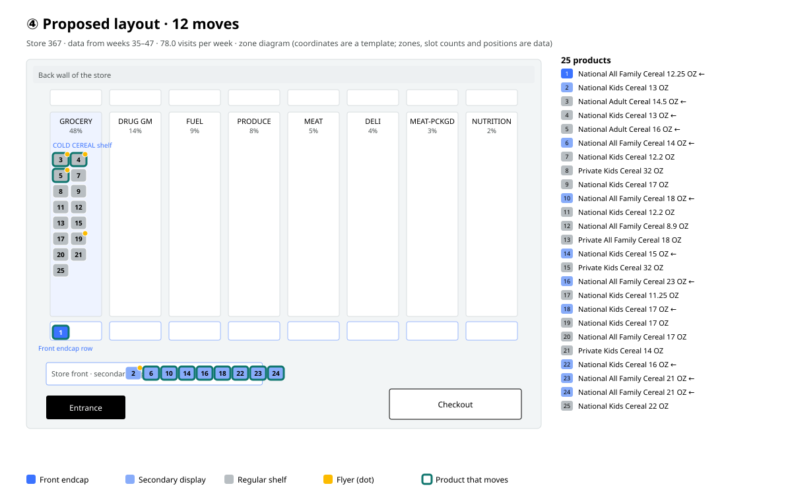

# One cycle · dunnhumby · store 367

Data: dunnhumby Complete Journey (84.51°), completejourney R package · 2,469 households · 457 stores · 1,469,307 receipt lines. Decision table of 1,996,300 rows (state weeks 1–26, training weeks 27–44, calibration weeks 45–47, test weeks 48–53).

Store choice: the store with display records and the most visits in the test weeks → **367** (78.0 visits per week, 127 households).

## ① Space map

Data from weeks 35–47. 8 aisles (share of department sales), 9 display types used by this store. Slots available to the category (a busy week: the 90th-percentile week): front endcap 1, secondary display 9. As of week 47: 0 front endcaps, 4 secondary displays, 21 shelf positions. Coordinates are a template; only the zones, slot counts and positions are data.

## ② Simulation · same shoppers, same luck

446 real visits · 95 households · 11,150 decisions · 200 draws. Baseline = week-47 layout held fixed.

| Plan | Expected sale visits | 90% range (shopper luck) | Revenue | vs. baseline | Draws above baseline |
|---|---|---|---|---|---|
| Actual displays as they were | 11.9 | 7–18 | $41.96 | ×0.89 (-1.5, $-1.97) | 11.5% |
| Week-47 layout held fixed | 13.4 | 8–20 | $43.93 | ×1.00 (+0.0, $+0.00) | 0.0% |
| Proposed layout | 19.5 | 13–27 | $72.12 | ×1.46 (+6.2, $+28.19) | 98.5% |

## ③ Validation · this store, unseen weeks

Simulation run with the actual displays as they were vs. actual sales: total **actual 18 vs. expected 11.9** (90% 7–18 ✓), 5 of 6 weeks within range, product rank correlation 0.23.

| Week | Visits | Actual | Expected | 90% range |
|---|---|---|---|---|
| 48 | 75 | 2 | 2.0 | 0–5 ✓ |
| 49 | 74 | 7 | 1.9 | 0–5 ✗ |
| 50 | 78 | 1 | 1.7 | 0–4 ✓ |
| 51 | 81 | 4 | 2.6 | 0–5 ✓ |
| 52 | 81 | 2 | 2.4 | 0–5 ✓ |
| 53 | 57 | 2 | 1.3 | 0–3 ✓ |

Validation across all stores is in `VALIDATION.md` (`python validate.py`).

## ④ Final layout

Objective: maximise revenue. For each product, the expected value on shelf, front endcap and secondary display is simulated over the same visits, and the choice is made as an assignment problem within this store's slot counts (front endcap 1, secondary display 9). Flyers are not a space, so they are left as they were.

12 products change:

| Product | Now | Proposed | Expected revenue vs. shelf |
|---|---|---|---|
| 1. National All Family Cereal 12.25 OZ | As usual | Front endcap | $+8.80 |
| 14. National Kids Cereal 15 OZ | As usual | Secondary display | $+4.73 |
| 6. National All Family Cereal 14 OZ | As usual | Secondary display | $+3.92 |
| 16. National All Family Cereal 23 OZ | As usual | Secondary display | $+3.52 |
| 10. National All Family Cereal 18 OZ | As usual | Secondary display | $+2.35 |
| 18. National Kids Cereal 17 OZ | As usual | Secondary display | $+2.35 |
| 24. National All Family Cereal 21 OZ | As usual | Secondary display | $+2.33 |
| 22. National Kids Cereal 16 OZ | As usual | Secondary display | $+2.27 |
| 23. National All Family Cereal 21 OZ | As usual | Secondary display | $+2.27 |
| 4. National Kids Cereal 13 OZ | Secondary display | As usual | $+0.00 |
| 3. National Adult Cereal 14.5 OZ | Secondary display | As usual | $+0.00 |
| 5. National Adult Cereal 16 OZ | Secondary display | As usual | $+0.00 |

Proposed vs. week-47 layout held fixed: expected 13.4 → 19.5 sale visits (×1.46), revenue $+28.19, above the baseline in 98.5% of 200 draws.

## Caveats when reading

- The unit of sales is "the number of visits that bought that product". It is not quantity.
- The effect of the proposed layout is a simulated value. That layout was never actually used, so it cannot be compared directly with real sales; the only evidence is ③ and the effect-size comparison in the full validation.
- In the backtest, the optimisation uses the visits that actually came in the test weeks (who came and when). It does not see the purchase outcomes (y), but this list of visits could not be known at decision time.
- The 90% range captures shopper luck only. Model error is checked only by the comparisons with actuals in ③ and `VALIDATION.md`.
- In the full validation, the model put the total about 10% low (684 vs 617) and put sales on visits that were on an endcap low (133 vs 80). The endcap effect size (3.66×, actual 3.18×) is within the actual range.
- Map coordinates are a template. The data has no floor plan. Only the zones, slot counts and current positions are data.
- Of the display codes, only the front endcap (3) is treated separately; the other displays are grouped in the model into a single "secondary display".
